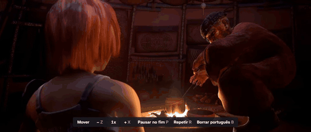

# Entrelinhas

Quem está começando no inglês costuma ficar entre duas escolhas ruins: assistir com legenda em
português e não aprender quase nada, ou assistir com legenda em inglês e não entender metade. O
Entrelinhas mostra as duas ao mesmo tempo, o inglês em cima e o português logo abaixo, por cima
do vídeo. Ele também traz o que ajuda a estudar: deixar o vídeo mais devagar, repetir uma frase,
borrar o português até você querer conferir e guardar palavras para revisar depois.

É uma extensão para o Google Chrome no computador. É gratuita, não pede conta e não envia nada
para servidor nenhum: a tradução é feita pelo próprio Chrome, dentro do seu computador.



No vídeo acima: a legenda dupla com as palavras pouco comuns sublinhadas; a tecla B borra o
português (o controle "Borrar português" acende na faixa); a tecla R volta para o começo da frase.
Cena de _Sintel_ (2010), © Blender Foundation, [durian.blender.org](https://durian.blender.org),
licença [CC BY 3.0](https://creativecommons.org/licenses/by/3.0/), com as legendas em inglês e
português do próprio filme.

## O que ela faz

- **Legenda dupla:** inglês em cima, português embaixo, numa caixa que você pode arrastar dentro do
  vídeo. Funciona também em tela cheia.
- **Tradução:** usa a legenda oficial em português quando o vídeo tem uma. Quando não tem, o Chrome
  traduz o inglês no seu computador.
- **Estudo:** velocidade de 0,5x a 2x, pausa automática no fim de cada frase, repetir a frase (também
  em 0,75x), português borrado até você passar o mouse ou apertar uma tecla.
- **Vocabulário:** clique numa palavra da legenda para ver a tradução e salvar com a frase e o momento
  do vídeo. Uma página de revisão traz as palavras de volta em intervalos cada vez maiores, e você
  pode exportar tudo para o [Anki](https://apps.ankiweb.net/).

## Como instalar

A extensão não está na Chrome Web Store. Você instala a partir de um arquivo baixado daqui, e leva
uns dois minutos.

Antes de começar: use o Chrome no computador, na versão 138 ou mais nova (menu ⋮ › Ajuda › Sobre o
Google Chrome). Em versões mais antigas, a legenda em inglês aparece, mas a tradução não.

1. Abra a página de [versões publicadas](https://github.com/guilhermeR3is/projeto-bilingue/releases/latest)
   e baixe o arquivo `entrelinhas-<versão>-chrome.zip`.
2. Extraia o arquivo numa pasta que você não vai apagar, por exemplo `Documentos/Entrelinhas`. O
   Chrome lê a extensão dessa pasta toda vez que abre, então ela precisa continuar ali.
3. No Chrome, digite `chrome://extensions` na barra de endereço e aperte Enter.
4. Ligue a chave **Modo do desenvolvedor**, no canto superior direito.
5. Clique em **Carregar sem compactação** e escolha a pasta do passo 2 (a que tem o arquivo
   `manifest.json` dentro).
6. Clique no ícone de quebra-cabeça ao lado da barra de endereço e fixe o Entrelinhas, para o ícone
   ficar sempre à vista.

Pronto. No YouTube, ligue a legenda em inglês do vídeo e a legenda dupla aparece. Na primeira vez,
o Chrome baixa o pacote de tradução inglês-português; a legenda avisa e pede um clique na página
para começar.

### Como atualizar

1. Baixe o `.zip` da versão nova na página de [versões publicadas](https://github.com/guilhermeR3is/projeto-bilingue/releases/latest).
2. Extraia por cima da pasta antiga, substituindo os arquivos.
3. Em `chrome://extensions`, clique no botão de recarregar (a seta circular) no cartão do Entrelinhas.
4. Recarregue as abas que já estavam abertas com vídeo. Até recarregar, elas continuam com a versão
   antiga desligada, e o popup não consegue ligar a legenda dupla nelas.

Suas palavras salvas e suas preferências continuam lá. Não clique em **Remover**: remover a extensão
apaga os dados dela.

## Onde funciona

| Onde                                                | Como ligar                                                                  | Observações                                                                      |
| --------------------------------------------------- | --------------------------------------------------------------------------- | -------------------------------------------------------------------------------- |
| YouTube                                             | Sozinho, ao ligar a legenda em inglês do vídeo                              | Também com a legenda automática. No anúncio, a legenda dupla sai e volta depois. |
| Sites com legenda própria do vídeo                  | Popup › **Ativar neste site**                                               | O Chrome pede permissão só para aquele endereço.                                 |
| Sites que desenham a legenda por conta própria      | Ativar e depois **Escolher a legenda na tela**, clicando na legenda do site | A extensão lembra a escolha para o site. Repetir e pausar valem fala por fala.   |
| Qualquer vídeo, com um arquivo `.srt` ou `.vtt` seu | Ativar e depois **Carregar arquivo de legenda**                             | Ajuste fino de atraso em passos de 0,1 s.                                        |
| Vídeo num player de outro endereço (iframe)         | Ativar o site e depois **Ativar também no player**                          | Recarregue a página depois de ativar o player.                                   |
| Netflix, Prime Video, Disney+, HBO Max              | Ainda não                                                                   | Planejado: um adaptador por plataforma, sem mexer na proteção dos vídeos.        |

Só o primeiro vídeo de cada página ganha legenda dupla, e o YouTube embutido em outros sites ainda
não funciona. Testado no Chrome; no Edge e em outros navegadores, não foi verificado.

Se um site mudar e a extensão não conseguir mais ler a legenda, ela sai do caminho: o vídeo continua
normal e o popup avisa que parou ali.

## Atalhos

Valem no YouTube e nos sites ativados, com a legenda dupla ligada. Dá para trocar qualquer tecla em
popup › **Atalhos do teclado**.

| Tecla   | O que faz                                   |
| ------- | ------------------------------------------- |
| Z e X   | Mais devagar e mais rápido (passos de 0,05) |
| P       | Liga e desliga a pausa no fim da frase      |
| R       | Repete a frase                              |
| Shift+R | Repete a frase em 0,75x                     |
| B       | Liga e desliga o português borrado          |
| V       | Mostra o português da frase atual           |

## Privacidade

Nenhum dado sai do seu computador. Não há conta, servidor, anúncio nem contagem de uso.

- **Tradução:** feita pela [Translator API](https://developer.chrome.com/docs/ai/translator-api) do
  Chrome, que roda no seu computador. O texto das legendas não é enviado a ninguém. O que o Chrome
  baixa, uma vez só, é o pacote de tradução.
- **Palavras salvas, traduções já feitas e preferências:** ficam no armazenamento da própria extensão
  no Chrome. Exportar para o Anki gera um arquivo no seu computador.
- **Permissões:**
  - acesso ao YouTube, o único site com suporte pronto;
  - nos outros sites, acesso só quando você clica em **Ativar neste site**, e só àquele endereço;
  - `storage`, para guardar as preferências e as palavras;
  - `scripting`, para entrar nos sites que você ativou;
  - `activeTab`, para o popup saber em que site você está quando o clica.

  Para tirar o acesso de um site, use popup › **Tirar o acesso a este site**.

A extensão usa só a legenda que o site já entrega no seu navegador. Ela não baixa, não guarda e não
redistribui vídeos nem legendas, e não mexe na proteção de conteúdo (DRM) de nenhuma plataforma.

## Leveza

Medido com `scripts/lightness.ts` em 24/10/2026: Chromium 156 do Playwright num Mac, build de teste
da extensão, métricas de tempo da página no DevTools (`Performance.getMetrics`), mediana de 3 rodadas
de 10 s cada, com e sem a extensão.

| Situação                                  | Script da página, sem a extensão | Com a extensão |
| ----------------------------------------- | -------------------------------- | -------------- |
| Página parada, sem vídeo                  | 0,0 ms                           | 0,0 ms         |
| Página sem vídeo que muda a cada 100 ms   | 15,9 ms                          | 20,9 ms        |
| Vídeo pausado com a legenda dupla na tela | 0,0 ms                           | 0,0 ms         |

- Nos sites que você não ativou, a extensão nem entra na página.
- Numa página sem vídeo que muda o tempo todo, o observador que espera um vídeo aparecer custa
  cerca de 5 ms a cada 10 s.
- Com o vídeo pausado, nenhum código da extensão roda. O trabalho total da página sobe de 2,4 ms para
  3,1 ms nesses 10 s, que é o navegador desenhando a caixa da legenda.
- Scripts que entram nas páginas: 113,75 kB nos sites ativados e 90,45 kB no YouTube, abaixo da meta
  de 150 kB. A lista de 25.000 palavras (200 kB) só é carregada quando o destaque de palavras está
  ligado.

O tempo gasto no service worker da extensão (a parte que guarda as palavras e as traduções) não
entra nessa conta.

## Como funciona

O código separa um **núcleo**, que não sabe nada sobre sites, de **adaptadores**, que sabem tirar a
legenda de cada tipo de player.

```
site → adaptador → falas em inglês com tempo → núcleo de legendas → tradução → caixa sobre o vídeo
                                                      ↑
                                       tempo atual do vídeo (busca binária)
```

- **Adaptadores** (`src/youtube`, `src/universal`): cada um implementa a interface `PlayerAdapter`
  (`src/session/player-adapter.ts`). Há quatro hoje: YouTube (lê a resposta de legenda que o próprio
  player pediu), legenda nativa do HTML5 (`video.textTracks`), legenda desenhada na tela (um
  `MutationObserver` limitado à legenda que a pessoa escolheu) e arquivo `.srt`/`.vtt`.
- **Núcleo** (`src/subtitles`): modelo `Cue`, leitores de WebVTT, SRT, TTML e do formato json3 do
  YouTube, escritos à mão, e o `SubtitleTrack`, que acha a fala do momento por busca binária.
- **Sessão** (`src/session`): liga adaptador, tradução, caixa e controles. Qualquer erro inesperado
  desliga a sessão com segurança e devolve o player ao site.
- **Tradução** (`src/translation`): Translator API no script de conteúdo; cache no IndexedDB do
  service worker, com as mensagens entre as partes validadas por [zod](https://zod.dev).
- **Caixa sobre o vídeo** (`src/overlay`): fica dentro de um Shadow DOM, então o CSS do site não
  mexe nela e o dela não mexe no site.
- **Vocabulário** (`src/vocabulary`): repetição espaçada por caixas de Leitner (1, 3, 7, 14, 30 e 60
  dias) e exportação em CSV no formato de importação do Anki.

## Decisões

- **Por que extensão, e não um programa:** a legenda precisa ficar por cima do player de sites de
  terceiros, ler a legenda que o site já entrega e acompanhar o vídeo quadro a quadro. Uma extensão
  roda dentro da página com esse acesso. Um programa separado teria que ler a tela.
- **Por que tradução no próprio computador:** sem servidor, o projeto não tem custo para quem usa nem
  para quem mantém, e o texto das legendas não sai do computador. O preço é exigir o Chrome 138 ou
  mais novo no computador.
- **Por que permissões opcionais por site:** pedir acesso a todos os sites na instalação assusta e
  não é necessário. O YouTube vem pronto; qualquer outro site só entra quando a pessoa clica em
  **Ativar neste site**, e o Chrome pergunta só por aquele endereço.
- **Por que fora da loja:** a publicação fica no GitHub, com o `.zip` de cada versão gerado pelo CI.
  O ID da extensão é fixo (chave `key` no manifest), para uma atualização extraída em outra pasta não
  perder as palavras salvas.

## Desenvolvimento

Requer Node.js 24 (há um `.nvmrc`).

```sh
npm ci
npm run dev        # modo de desenvolvimento do WXT, recarrega ao salvar
npm test           # testes unitários (Vitest)
npm run test:e2e   # testes ponta a ponta (Playwright) em páginas de teste locais
npm run build      # build de produção em .output/chrome-mv3
npm run zip        # .zip da versão
```

Os testes ponta a ponta nunca acessam sites reais: usam as páginas de `e2e/test-page`, um "YouTube
falso" servido localmente e um tradutor falso, porque o Chromium do Playwright não tem o modelo de
tradução. O CI (`.github/workflows/ci.yml`) roda lint, tipos, formatação e os dois tipos de teste a
cada envio; quando chega uma tag `v*`, publica a versão nos Releases com o `.zip`.

Para gerar de novo os ícones, rode `node scripts/icons.ts`; a lista de palavras, `scripts/word-ranks.py`.

## Créditos e licença

O código está sob a [licença MIT](LICENSE).

- Lista de frequência de palavras: derivada do [wordfreq](https://github.com/rspeer/wordfreq) 3.1.1,
  de Robyn Speer, sob [CC BY-SA 4.0](https://creativecommons.org/licenses/by-sa/4.0/). Os créditos
  completos das fontes de dados estão em [`public/word-ranks-license.txt`](public/word-ranks-license.txt).
- Fonte: [Atkinson Hyperlegible Next](https://github.com/googlefonts/atkinson-hyperlegible-next),
  sob a SIL Open Font License 1.1.
- O `.zip` de cada versão leva os avisos de licença do zod, do punycode e da fonte em
  `THIRD-PARTY-NOTICES.txt`.
- Arquivos de teste: web-platform-tests e w3c/imsc-tests (BSD de 3 cláusulas) e a legenda de
  _Sintel_ (CC BY 3.0); detalhes em [`src/subtitles/fixtures/README.md`](src/subtitles/fixtures/README.md).
